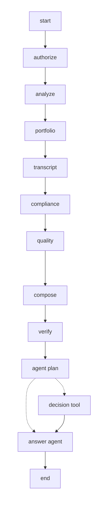

# XY Advisory Intelligence — Streamlit + LangGraph

A read-only, permission-scoped analytical **prototype** for the Synthetic XY
financial advisory dataset. Optional local model inference; no CRM writes or cloud API keys.
The workflow uses **real LangGraph `StateGraph` nodes** to coordinate existing
Python data-science and governance logic. The chat runs one bounded AI agent: verified analysis, d3-edge tool selection, optional source review and streamed Gemma synthesis. Disable local models for a deterministic report.

## Quick start

Follow the [project quick start](README.md#quick-start) to install dependencies
with uv and launch the dashboard.

Open Streamlit's URL, typically `http://localhost:8501`.
Select the **demo** advisor (R02, R07 or R09), then a household in their
explicit permission list, and ask a question in **Ask the agents**.

Example prompts:

- R02 / H012 — "What is the risk profile conflict and conduct issue?"
- R07 / H018 — "Was there a prompt injection attempt?"
- R09 / H016 — "Show injection security flags"
- R07 / H009 — "Which fees are missing?"
- R07 / H002 — "What suitability data quality issues exist?"

Select **LangGraph execution** to see the *actual compiled graph* (`get_graph`)
and which nodes were executed during the last question. Click **Mermaid source**
to inspect the compiled graph's Mermaid definition.

## Architecture

- **authorize**: fail-closed household permission gate; no privileged query before authorization.
- **analyze**: immutable, dataset-specific portfolio and evidence analysis; raw notes remain in repository.
- **portfolio**: numerical subset of the validated report.
- **transcript**: timestamped evidence pointers, not raw transcript or embedded instructions.
- **compliance**: risk-profile conflicts, assurances, injection indicators.
- **quality**: missing data, valuation reconciliation and review gaps.
- **compose**: question-dependent, deterministic sourced narrative (no probabilistic claims).
- **verify**: independently reconciles totals and fee coverage; asserts no write actions.
- **agent_plan**: d3-edge selects source review or report-only synthesis; uncertain plans include source review.
- **decision_tool**: reauthorizes and reads redacted source evidence, returning typed advisory decisions.
- **answer_agent**: Gemma synthesizes the verified report and decisions, streaming text to the chat.

The graph is compiled in `src/xy_agents/graph.py` using `StateGraph`, `START`,
`END`, `add_node`, `add_edge` and `.compile()`. The UI consumes node updates and
custom token events to show actual execution and streaming generation. Disabling
local models ends the graph after verification. Durable persistence is not configured.

## Dashboard tabs

1. **Overview** — aggregate *authorized* households, portfolio totals and severity distributions.
2. **Household & sources** — holdings, metrics, findings, permission-gated, redacted excerpts.
3. **Ask the agents** — role- and household-scoped chat; evidence citations are dataset pointers.
4. **LangGraph execution** — dynamic compiled graph visualization, node trace and verifier checks.
5. **Audit & governance** — authorization events, prototype security boundaries and requirements.

## Security boundaries

The advisor dropdown simulates an authenticated principal but **is not login**:
any user who can open this demo can choose any advisor. Do not deploy this UI to
real financial clients as-is. See the [production requirements](README.md#critical-production-requirements) for authentication, data protection, audit and deployment controls.

Read permissions are enforced before each analytical read. Raw CRM notes and
transcripts are **never passed into graph state**. The decision tool receives scoped, redacted synthetic sources locally; Gemma receives only the verified report and decision metadata. The UI
shows authorized, PII-redacted excerpts only after explicit user action.
Some PII could evade regex redaction: do not use real sensitive transcripts
without a vetted detection and privacy-review pipeline.

Injection screening uses heuristics and is **not a complete prompt-injection
security solution**. It quarantines known test indicators; review required.
The source dataset intentionally contains missing fees, mismatches and
suitability gaps. Missing fees are not silently inferred. Nothing in this
prototype executes customer-profile updates or investment orders.

## Limits

The app uses in-memory session audit logs, read-only generated briefs and
rule-based verified findings. Gemma 2B and Decision 3.0 d3-edge run as agent nodes within the same graph; see [local model setup](README.md#local-models). Jev is not integrated.
The agent is bounded to choosing read-only source review or report-only synthesis. It cannot call arbitrary tools or update records. No vendor privacy
contract or calibrated Swedish model classifier is implied.

### Reading local results

Submit a question in **Ask the agents**. **Verified findings** shows the checked report. **Decision model results · d3-edge** shows the bounded
answers and scores as soon as decision evaluation completes. **Generated
explanation · Gemma 2B** is a separate prose section that streams text as Ollama
produces it. Blank explanations and empty decision tables are hidden. Timed
indicators distinguish decision evaluation from generation; initial model
loading and prompt processing may still delay the first token. Completed
decisions remain visible if Gemma fails, and interrupted prose is retained as
a partial explanation.

The **Agent tool selection** expander shows the model's plan and scores. LangGraph execution includes agent_plan, decision_tool (when chosen) and answer_agent. Model failures preserve verified findings and completed decisions; partial explanations are marked incomplete.
